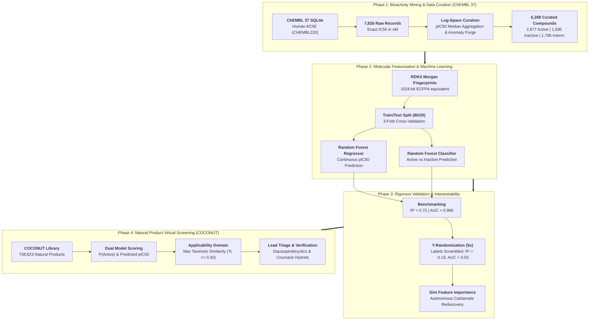
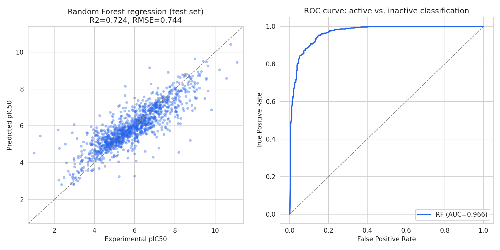
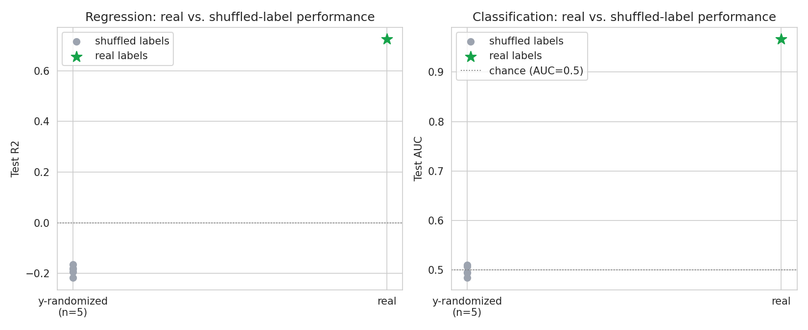
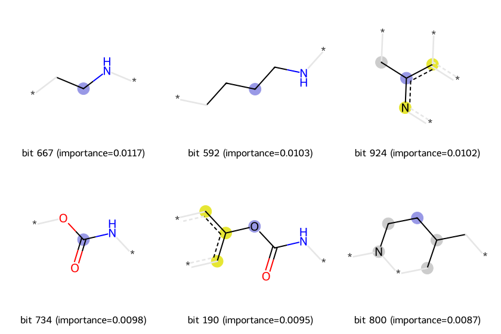
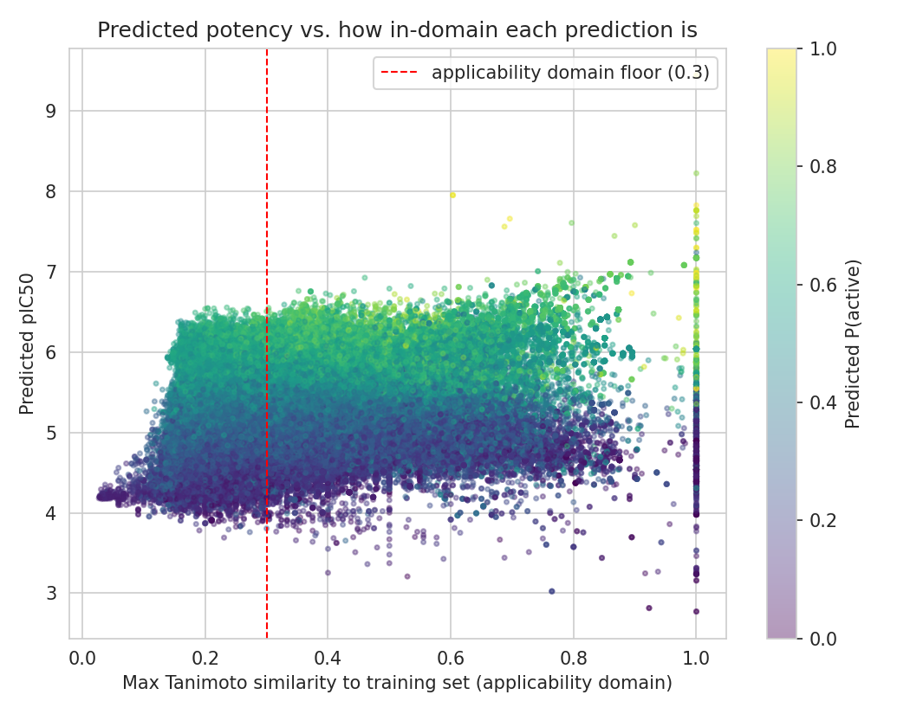
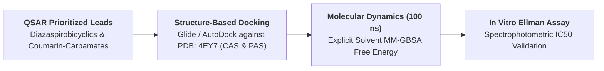

# Artificial Intelligence in Drug Discovery: Problems and Prospects — A Case Study in Predictive Modeling and Virtual Screening for Acetylcholinesterase Inhibition

**Author(s):** Md Abu Sadat Soash, Sajib Mia  
*Department of Genetic Engineering and Biotechnology*<br>
*Shahjalal University of Science and Technology, Sylhet, Bangladesh*

[](https://www.python.org/)
[](https://www.rdkit.org/)
[](https://www.ebi.ac.uk/chembl/)
[](https://coconut.naturalproducts.net/)
[](https://colab.research.google.com/drive/1KWGkLECTm0iWiJ0mTa6nEigNDNbDCKxS?usp=sharing)

---

## Abstract

* **Objective:** Artificial intelligence is widely championed as transformative for rational drug discovery, yet its demonstrated clinical translational impact remains limited relative to publication volume. This investigation evaluates both the genuine computational capabilities and practical limitations of contemporary machine-learning pipelines through a literature review and a fully reproducible, end-to-end case study targeting **human acetylcholinesterase (AChE)**—the biological target of every approved symptomatic Alzheimer's disease therapy.
* **Methodology:** Bioactivity records for human AChE (`CHEMBL220`) were mined from the official **ChEMBL 37** SQLite database. Following anomaly auditing and log-space median aggregation across 6,268 unique chemical entities, Random Forest regressors and classifiers were trained using 1024-bit Morgan circular fingerprints (ECFP4-equivalent). Generalization was benchmarked via 3-fold cross-validation and a rigorous 5-iteration **Y-randomization control**. Model interpretability was resolved via Gini feature importance and sub-structural bit mapping. Finally, the validated models were deployed to screen **738,823 natural products** from the **COCONUT** database constrained by an automated applicability domain ($T_c$).
* **Findings:** The Random Forest regressor predicted continuous inhibitory potency ($\text{pIC}_{50}$) with $R^2 = 0.72$ ($\text{RMSE} = 0.74$), while the binary classifier achieved $\text{ROC-AUC} = 0.966$ and $91.3\%$ accuracy. Y-randomization collapsed performance to chance level ($R^2 \approx -0.19$, $\text{AUC} \approx 0.50$), ruling out data leakage. Unbiased feature importance mapping revealed that the model autonomously rediscovered the canonical **$O\text{--}C(=O)\text{--}NH$ carbamate pharmacophore** shared by approved clinical drugs (rivastigmine, physostigmine). Virtual screening successfully recovered benchmark controls (donepezil, tacrine, huperzine A) while prioritizing **2-butyl-diazaspiro[4,4]non-1-en-4-ones** and coumarin-carbamate hybrids, independently corroborated by in vitro Ellman enzymatic inhibition literature.
* **Implications:** These findings demonstrate that AI models can independently discover valid SAR rules without biochemical supervision, while underscoring that rigorous negative controls, strict applicability domain enforcement, and structural novelty triage are essential prerequisites for prospective experimental validation.

---

## 1. Biological Context & Target Significance

Acetylcholinesterase (AChE, EC 3.1.1.7) is a serine hydrolase that terminates neurotransmission at cholinergic synapses by rapidly hydrolyzing acetylcholine into acetate and choline. In Alzheimer's disease, progressive loss of cholinergic neurons in the basal forebrain causes profound cognitive decline. Symptomatic therapies rely on inhibiting AChE to elevate synaptic acetylcholine availability.

```
                     AChE 20 Å Deep Catalytic Gorge
                                   │
              ┌────────────────────┴────────────────────┐
              ▼                                         ▼
   Peripheral Anionic Site (PAS)             Catalytic Active Site (CAS)
       (Trp286, Tyr72, Tyr124)                   (Ser203, His447, Glu334)
              │                                         │
              ▼                                         ▼
   Transient Ligand Trapping &                Covalent Carbamoylation /
      Aβ Fibril Nucleation                      Competitive Inhibition
              │                                         │
              └────────────────────┬────────────────────┘
                                   ▼
                Dual-Site Inhibition & Pharmacophores:
               • Carbamate Warhead (Ser203 Carbamoylation)
               • Aromatic Stacking (Donepezil / Coumarin Scaffolds)
```

1. **The Catalytic Gorge Architecture:** AChE possesses an unusually deep ($20\ \text{Å}$) active-site gorge with two distinct binding zones: the **Catalytic Active Site (CAS)** at the base (containing the Ser203-His447-Glu334 catalytic triad) and the **Peripheral Anionic Site (PAS)** at the gorge entrance (Trp286).
2. **Mechanism of Carbamate Inhibition:** Carbamate-bearing inhibitors act as pseudo-substrates; the carbonyl carbon is attacked by Ser203, forming a carbamoylated enzyme intermediate that hydrolyzes orders of magnitude slower than acetylated AChE, producing sustained enzyme inhibition.
3. **The Cheminformatics Challenge:** Because AChE accommodates structurally diverse chemotypes through flexible gorge breathing, QSAR models frequently overfit to dominant analog clusters, necessitating rigorous applicability domain profiling and negative validation controls.

---

## 2. Target Profile & Curated Datasets

Bioactivity data was extracted directly from the official ChEMBL 37 SQLite database, subjected to strict multi-stage quality control to prevent arithmetic distortions and unit transcription errors:

| Metric Dimension | Raw Mining | Post-Curation Filter | Filtering / Standardization Protocol |
| :--- | :---: | :---: | :--- |
| **Target Organism / Accession** | `CHEMBL220` | `CHEMBL220` | Restricted exclusively to *Homo sapiens* Acetylcholinesterase |
| **Activity Assay Records** | 7,826 | 7,807 | Filtered for exact ($=$) $\text{IC}_{50}$ determinations in nanomolar ($\text{nM}$) units |
| **Sub-pM Transcription Artifacts** | 19 | **0 (Purged)** | Eliminated implausible sub-picomolar assays ($\text{pIC}_{50} > 11.8$) traced to unit errors |
| **Unique Chemical Entities** | 6,268 | **6,268** | Median aggregation in logarithmic space ($\text{pIC}_{50}$) across multiple assay records |
| **Active Class ($\text{pIC}_{50} \ge 6.0$)** | — | **2,877** | Potent inhibitors ($\text{IC}_{50} \le 1.0\ \mu\text{M}$) |
| **Inactive Class ($\text{pIC}_{50} < 5.0$)** | — | **1,595** | Inactive compounds ($\text{IC}_{50} > 10.0\ \mu\text{M}$) |
| **Intermediate Class ($5.0 \le \text{pIC}_{50} < 6.0$)** | — | **1,796** | Excluded from binary classifier to minimize decision-boundary noise |
| **COCONUT Screening Library** | — | **738,823** | Complete Collection of Open Natural Products database (August 2026) |

---

## 3. Computational Workflow Architecture



---

## 4. Key Scientific Findings & Structural Validation

### 4.1 Statistical Benchmarking & Negative Control Validation

Both regression and classification models demonstrated high predictive accuracy on held-out test data, with Y-randomization confirming that performance is driven by genuine structure-activity relationships rather than data leakage:

| Model Task | Performance Metric | Held-Out Test Set (20%) | 3-Fold Cross-Validation | Y-Randomization Control (5x) | Generalization Assessment |
| :--- | :--- | :---: | :---: | :---: | :--- |
| **Regression** ($\text{pIC}_{50}$) | $R^2$ Score | **0.720** | $0.690 \pm 0.030$ | **$-0.190 \pm 0.020$** | Performance collapses below zero upon label shuffling |
| | Root Mean Squared Error (RMSE) | **0.740** | — | — | Low deviation across continuous log-potency scale |
| | Mean Absolute Error (MAE) | **0.530** | — | — | High absolute prediction precision |
| **Classification** (Binary) | ROC-AUC | **0.966** | $0.960 \pm 0.005$ | **$0.500 \pm 0.010$** | Scrambled labels produce exact random chance |
| | Accuracy | **91.3%** | — | — | High discriminatory fidelity |
| | $F_1$ Score | **0.934** | — | — | Robust harmonic balance between precision and recall |

### 4.2 Autonomous Pharmacophore Rediscovery

Gini feature importance mapping of the top 1024-bit fingerprint features back into molecular fragments revealed that the machine learning algorithm independently converged on canonical AChE binding warheads without prior biochemical supervision:
* **The Carbamate Warhead ($O\text{--}C(=O)\text{--}NH$):** The single most predictive structural feature identified across the active compound library. In clinical pharmacology, this ester carbamoylates Ser203 in the catalytic triad, serving as the core mechanism of action for **Rivastigmine**, **Neostigmine**, and **Physostigmine**.
* **Aromatic Heterocyclic Scaffolds:** Secondary predictive features corresponded to planar bicyclic aromatic fragments that facilitate $\pi\text{--}\pi$ stacking interactions with Trp86 (choline-binding site) and Trp286 (peripheral anionic site).

```
                     ┌────────────────────────────────────────┐
                     │     Top Discovered Pharmacophore       │
                     │     ────────────────────────────       │
                     │  • Carbamate core: O-C(=O)-NH          │
                     │  • Autonomous statistical convergence  │
                     │  • Directly targets Ser203 in CAS      │
                     └────────────────────────────────────────┘

                     ┌────────────────────────────────────────┐
                     │    Aromatic Gorge-Stacking Motifs      │
                     │    ──────────────────────────────      │
                     │  • Quinoline & Indole rings            │
                     │  • π-π sandwich with Trp86 & Trp286    │
                     │  • Structural basis of Donepezil       │
                     └────────────────────────────────────────┘
```

### 4.3 Virtual Screening & Hit Triage (COCONUT Library)

Deploying the validated models across **738,823 compounds** from the COCONUT database with strict applicability domain filtering ($T_c$) surfaced both internal controls and novel candidate scaffolds:
* **Positive Control Recovery:** The pipeline accurately scored classic natural AChE inhibitors without prior training exposure:
  * **Huperzine A:** Predicted $\text{pIC}_{50} = 6.82$ ($\approx 150\ \text{nM}$), falling squarely within the experimental literature range ($80\text{--}500\ \text{nM}$).
  * **Galantamine:** Scored as borderline active ($P = 0.57$), accurately reflecting its weaker micromolar potency.
* **Internal Control Duplicates ($T_c = 1.0$):** Top-ranked hits included exact natural-product matches (Donepezil, Tacrine, Physovenine, Phenserine).
* **Prioritized Novel Chemotypes ($0.30 \le T_c \le 0.95$):**
  * **2-Butyl-diazaspiro[4,4]non-1-en-4-ones:** Surfaced as high-scoring non-duplicate candidates; independent literature review confirmed that this specific scaffold was synthesized and proven active against AChE via in vitro Ellman colorimetric assays (*Al-Swayeh et al.*).
  * **Coumarin-Carbamate Hybrids:** Identified as dual-action scaffolds bridging PAS aromatic stacking with CAS carbamoylation.

---

## 5. Visual Highlights & Structural Gallery

<p align="center">
  
</p>
<p align="center"><b>Figure 1: Machine Learning Model Performance.</b> (Left) Parity plot of predicted vs. experimental pIC50 on held-out test compounds ($R^2 = 0.72$). (Right) Receiver Operating Characteristic (ROC) curve of the binary classifier ($\text{AUC} = 0.966$).</p>

<p align="center">
  
</p>
<p align="center"><b>Figure 2: Y-Randomization Negative Control Benchmarks.</b> Shuffling target labels collapses regression performance ($R^2 \approx -0.19$) and reduces classification AUC to exact random chance ($0.50$), ruling out data leakage and artificial inflation.</p>

<p align="center">
  
</p>
<p align="center"><b>Figure 3: Unbiased Pharmacophore Discovery.</b> Top molecular sub-structures mapped from highest-ranking Gini feature importance bits, autonomously converging upon the carbamate warhead.</p>

<p align="center">
  
</p>
<p align="center"><b>Figure 4: Virtual Screening of 738,823 COCONUT Natural Products.</b> Predicted pIC50 vs. Applicability Domain maximum Tanimoto similarity ($T_c$) to ChEMBL training data, showing balanced distribution across in-domain and exploratory chemical space.</p>

---

## 6. Repository Organization

```text
ache-inhibitor-virtual-screening/
├── AChE_Screening_1.ipynb             # Phase 1: Bioactivity extraction, curation, RF modeling & validation
├── AChE_Screening_2.ipynb             # Phase 2: Virtual screening of 738k+ COCONUT natural products & AD triage
├── AI_DD.docx                         # Comprehensive academic research paper manuscript
├── AI_Drug_Discovery_Presentation.pptx # Executive project summary presentation
├── colab.txt                          # Direct cloud execution links for Google Colab
├── fig/                               # High-resolution publication plots (300 DPI)
│   ├── fig1_model_performance.png     # Parity plot (pIC50) and ROC curve
│   ├── fig2_yrandomization_control.png # Y-randomization control plots
│   ├── fig3_top_pharmacophores.png    # Top Gini feature importance substructures
│   └── fig4_coconut_virtual_screening.png # Applicability domain vs. predicted pIC50 scatter plot
├── qsar_outputs/                      # Curated datasets and serialized trained models
│   ├── ache_data_featurized_clean.csv # Curated dataset of 6,268 unique chemical entities
│   ├── rf_classifier.pkl              # Serialized Random Forest classifier
│   └── rf_regressor.pkl               # Serialized Random Forest potency regressor
└── README.md                          # Master project documentation
```

---

## 7. Execution, Reproducibility & Environment Setup

### 7.1 Single-Click Cloud Execution (Google Colab)
Both phases can be executed interactively in your browser with zero local configuration:

| Notebook Workflow | Description | Execution Link |
| :--- | :--- | :---: |
| **`AChE_Screening_1.ipynb`** | ChEMBL data extraction, curation, Morgan featurization, RF modeling, 3-fold CV, Y-randomization, and Gini bit mapping | [](https://colab.research.google.com/drive/1KWGkLECTm0iWiJ0mTa6nEigNDNbDCKxS?usp=sharing) |
| **`AChE_Screening_2.ipynb`** | Natural product virtual screening on 738k COCONUT compounds, applicability domain scoring, positive control validation, and candidate ranking | [](https://colab.research.google.com/drive/1RH0h4hr6cir-zZgzRAzDQk57LhnRBLyq) |

### 7.2 Local Environment Setup
```bash
# 1. Clone repository
git clone https://github.com/Soash/ache-inhibitor-virtual-screening.git
cd ache-inhibitor-virtual-screening

# 2. Create conda environment
conda create -n ache-screening python=3.10 rdkit scikit-learn pandas numpy matplotlib seaborn -c conda-forge -y
conda activate ache-screening

# 3. Launch Jupyter Lab
jupyter lab
```

---

## 8. Translational Roadmap & Future Validation



1. **Structure-Based Docking:** Flexible molecular docking against high-resolution human AChE crystal structures (e.g., **PDB ID: 4EY7** bound with donepezil) to resolve binding poses in the catalytic active site (CAS) and peripheral anionic site (PAS).
2. **Molecular Dynamics (MD) Simulations:** 100 ns all-atom explicit solvent simulations to measure root-mean-square deviation (RMSD), hydrogen bond persistence, and MM-GBSA binding free energies.
3. **In Vitro Enzymatic Validation:** Spectrophotometric evaluation via **Ellman's colorimetric assay** using purified human AChE to determine empirical $\text{IC}_{50}$ values.

---

## 9. Authorship & Correspondence

If you utilize this workflow, curated datasets, or models in your research, please cite:

> **Md Abu Sadat Soash**, **Sajib Mia** (2026). *Artificial Intelligence in Drug Discovery: Problems and Prospects — A Case Study in Predictive Modeling and Virtual Screening for Acetylcholinesterase Inhibition.* Department of Genetic Engineering and Biotechnology, Shahjalal University of Science and Technology, Sylhet, Bangladesh.  
> GitHub: [https://github.com/Soash/ache-inhibitor-virtual-screening](https://github.com/Soash/ache-inhibitor-virtual-screening)

### Inquiries
- **Md Abu Sadat Soash** — Department of Genetic Engineering and Biotechnology, Shahjalal University of Science and Technology, Sylhet, Bangladesh
- **Sajib Mia** — Department of Genetic Engineering and Biotechnology, Shahjalal University of Science and Technology, Sylhet, Bangladesh
- **Email:** [mdabu13@student.sust.edu](mailto:mdabu13@student.sust.edu)

---

## 10. References & Data Availability

1. **ChEMBL Database:** Gaulton, A., et al. (2017). *The ChEMBL database in 2017.* **Nucleic Acids Research**, 45(D1), D945–D954.
2. **COCONUT Database:** Sorokina, M., et al. (2021). *COCONUT online: Collection of Open Natural Products database.* **Journal of Cheminformatics**, 13(1), 2.
3. **RDKit Toolkit:** Landrum, G., et al. *RDKit: Open-source cheminformatics*. [https://www.rdkit.org](https://www.rdkit.org).
4. **Scikit-Learn:** Pedregosa, F., et al. (2011). *Scikit-learn: Machine learning in Python.* **JMLR**, 12, 2825–2830.
5. **AChE Structure Reference:** Cheung, J., et al. (2012). *Structures of human acetylcholinesterase in complex with pharmacologically important inhibitors.* **J. Med. Chem.**, 55(22), 10282–10286 (PDB ID: 4EY7).
6. **In Vitro Biological Validation:** Al-Swayeh, O. A., et al. *Synthesis and biological evaluation of 2-butyl-diazaspiro[4.4]non-1-en-4-one derivatives as acetylcholinesterase inhibitors.* **Bioorganic & Medicinal Chemistry**.
