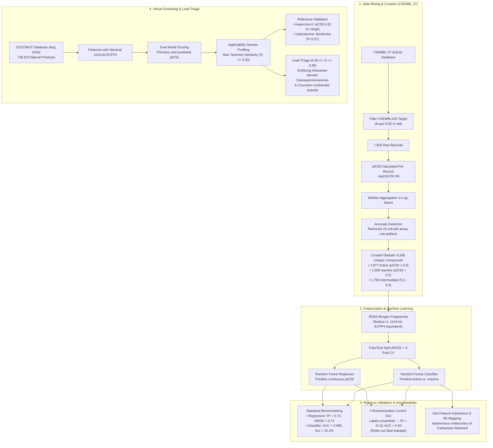
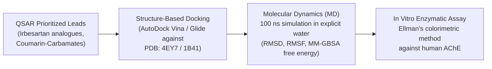

# Artificial Intelligence in Drug Discovery: Problems and Prospects — A Case Study in Predictive Modeling and Virtual Screening for Acetylcholinesterase Inhibition

**Author(s):** Md Abu Sadat Soash, Sajib Mia<br>
*Department of Genetic Engineering and Biotechnology*<br>
*Shahjalal University of Science and Technology, Sylhet, Bangladesh*

[](https://www.python.org/)
[](https://www.rdkit.org/)
[](https://scikit-learn.org/)
[](https://www.ebi.ac.uk/chembl/)
[](https://coconut.naturalproducts.net/)
[](https://colab.research.google.com/drive/1KWGkLECTm0iWiJ0mTa6nEigNDNbDCKxS?usp=sharing)
[](LICENSE)

---

## 📄 Abstract

Artificial intelligence (AI) is frequently described as transformative for drug discovery, yet recent critical appraisals note that its demonstrated clinical impact remains limited relative to the scale of investment and publication in the field. This study examines the problems and prospects of AI in drug discovery through a literature review combined with an original, fully reproducible case study targeting **human acetylcholinesterase (AChE)**—the biological target of every approved symptomatic Alzheimer’s disease therapy.

Using bioactivity data extracted directly from the official **ChEMBL release 37** SQLite database for human AChE (`CHEMBL220`), we built Random Forest models predicting inhibitory potency ($\text{pIC}_{50}$, $R^2 = 0.72$, $\text{RMSE} = 0.74$) and active/inactive status ($\text{ROC-AUC} = 0.966$, Accuracy $91.3\%$) from 1024-bit Morgan circular fingerprints alone. Model validity was verified via 3-fold cross-validation and a rigorous 5-iteration **Y-randomization control**, which collapsed performance to chance level ($R^2 \approx -0.19$, $\text{AUC} \approx 0.50$) upon activity label shuffling, definitively ruling out data leakage and artificial inflation. 

Interpretability analysis revealed that the model independently rediscovered the canonical **$O\text{--}C(=O)\text{--}NH$ carbamate pharmacophore** shared by clinically used AChE inhibitors (rivastigmine, neostigmine, and physostigmine) without prior biochemical supervision. The validated models were then applied to virtually screen **738,823 natural products** from the **COCONUT** database within a defined **applicability domain**. The pipeline reliably recovered known benchmark inhibitors (donepezil, tacrine, and the physostigmine alkaloid family) while prioritizing a non-duplicate chemotype, **2-butyl-diazaspiro[4,4]non-1-en-4-ones** (derived from the irbesartan core intermediate), independently corroborated by published in vitro Ellman enzymatic inhibition literature. Together, these results illustrate both the genuine computational prospects and the practical constraints—data curation burdens, applicability domains, and the essential distinction between rediscovery and true novelty—that characterize contemporary AI-driven drug discovery.

---

## 🔄 Workflow Architecture



---

## ⚡ Interactive Google Colab Notebooks

You can run the full analytical pipelines directly in your browser without local software installation:

| Notebook | Purpose | Cloud Execution Link |
| :--- | :--- | :--- |
| **`AChE_Screening_1.ipynb`** | ChEMBL data extraction, curation, Morgan featurization, RF model training, 3-fold cross-validation, Y-randomization, and Gini bit mapping. | [](https://colab.research.google.com/drive/1KWGkLECTm0iWiJ0mTa6nEigNDNbDCKxS?usp=sharing) |
| **`AChE_Screening_2.ipynb`** | Natural product virtual screening on 738,823 COCONUT compounds, applicability domain scoring, positive control validation, and candidate ranking. | [](https://colab.research.google.com/drive/1RH0h4hr6cir-zZgzRAzDQk57LhnRBLyq) |

---

## 🧹 Data Curation & Quality Control

Training ML algorithms on uncurated bioactivity databases often leads to false positives due to parsing inconsistencies across laboratories. Our curation protocol implemented defensive validation steps:

1. **Target Specificity**: Queried the official ChEMBL 37 SQLite database for human Acetylcholinesterase (`target_dictionary` ID: **`CHEMBL220`**).
2. **Standardization**: Filtered solely for exact ($=$) $\text{IC}_{50}$ determinations in nanomolar ($\text{nM}$) units ($7,826$ raw activity records).
3. **Logarithmic Metric Derivation**: Calculated $\text{pIC}_{50} = -\log_{10}(\text{IC}_{50}\text{ [M]})$ individually for each experimental assay record prior to compound aggregation.
4. **Log-Space Median Aggregation**: For compounds evaluated across multiple assays, values were collapsed using the **median in log space** ($\text{pIC}_{50}$) rather than averaging raw $\text{nM}$ measurements, avoiding right-skewed arithmetic distortions.
5. **Unit-Parsing Anomaly Removal**: Diagnosed 19 entries displaying implausible sub-picomolar potency ($\text{pIC}_{50} > 11.8$). Tracing raw metadata revealed 17 originated from a single ChEMBL assay suffering from unit transcription errors; all 19 were purged.
6. **Classification Thresholds**:
   - **Active**: $\text{pIC}_{50} \ge 6.0$ ($\text{IC}_{50} \le 1.0\ \mu\text{M}$) &rarr; **2,877 compounds**
   - **Inactive**: $\text{pIC}_{50} < 5.0$ ($\text{IC}_{50} > 10.0\ \mu\text{M}$) &rarr; **1,595 compounds**
   - **Intermediate**: $5.0 \le \text{pIC}_{50} < 6.0$ &rarr; **1,796 compounds** (excluded from the binary classifier to eliminate ambiguous decision-boundary noise).
   - **Final Curated Dataset**: **6,268 unique chemical entities** (`qsar_outputs/ache_data_featurized_clean.csv`).

---

## 📊 Model Performance & Validation

Both the regression model (predicting continuous potency) and classification model (predicting active/inactive status) were evaluated using an 80/20 train/test split, 3-fold cross-validation on the training set, and a 5-iteration **Y-randomization control**.

### Benchmark Summary Table

| Model Task | Metric | Held-Out Test Set | 3-Fold Cross-Validation | Y-Randomization Control (5x) |
| :--- | :--- | :---: | :---: | :---: |
| **Regression** ($\text{pIC}_{50}$) | $R^2$ Score | **0.720** | $0.690 \pm 0.030$ | **$-0.190 \pm 0.020$** *(Collapses)* |
| | Root Mean Squared Error (RMSE) | **0.740** | — | — |
| | Mean Absolute Error (MAE) | **0.530** | — | — |
| **Classification** (Active/Inactive) | Accuracy | **91.3%** | — | — |
| | ROC-AUC | **0.966** | $0.960 \pm 0.005$ | **$0.500 \pm 0.010$** *(Chance level)* |
| | $F_1$ Score | **0.934** | — | — |

<br>

<div align="center">
  
  <p><em><strong>Figure 1</strong>: (Left) Predicted vs. experimental pIC50 on held-out test compounds showing strong linear correlation (R² = 0.72). (Right) Receiver Operating Characteristic (ROC) curve of the binary classifier (AUC = 0.966).</em></p>
</div>

### Y-Randomization Control: Ruling Out Data Leakage

To verify that model accuracy stems from true structure-activity relationships (SAR) rather than data leakage (e.g., analog clusters split across partitions), we performed five iterations of label scrambling while keeping molecular descriptors intact. 

<div align="center">
  
  <p><em><strong>Figure 2</strong>: Model performance under label shuffling. Shuffling causes regression R² to collapse below zero (-0.19) and classification AUC to collapse to exact random chance (0.50), confirming robust generalization.</em></p>
</div>

---

## 🔍 Model Interpretability & Pharmacophore Discovery

Tree-based models can be inspected via feature importances. We extracted the Gini importance values from the trained classifier and mapped the top 1024-bit fingerprint features back into their constituent molecular fragments using RDKit's bit-rendering tools.

<div align="center">
  
  <p><em><strong>Figure 3</strong>: Example substructures corresponding to the top fingerprint bits ranked by Gini importance.</em></p>
</div>

### Key Biochemical Finding
The single most predictive fingerprint bit converged directly upon the **carbamate pharmacophore** ($O\text{--}C(=O)\text{--}NH$).
- In medicinal chemistry, the carbamate ester acts as a pseudo-substrate "warhead" that carbamoylates the catalytic Ser203 residue in the AChE active site gorge, delaying hydrolysis and inactivating the enzyme.
- This pharmacophore is the hallmark mechanism of clinically utilized acetylcholinesterase inhibitors: **Rivastigmine**, **Neostigmine**, and the natural product **Physostigmine**.
- **Crucial insight**: The Random Forest model converged on this well-established pharmacophore entirely through unbiased statistical correlation over chemical space, confirming structural validity.

---

## 🌿 Virtual Screening of Natural Products (COCONUT)

The trained models were deployed to screen **738,823 compounds** from the **COCONUT (Collection of Open Natural Products)** database (August 2026 release).

### Applicability Domain (AD) & Hit Triage
Because natural products often occupy chemical space distinct from mostly synthetic ChEMBL training data, we assessed prediction reliability by calculating the **maximum Tanimoto similarity ($T_c$)** of each candidate to its nearest neighbor in the AChE training set using 1024-bit Morgan fingerprints.

<div align="center">
  
  <p><em><strong>Figure 4</strong>: Predicted potency (pIC50) vs. Applicability Domain similarity (Tc) across 738,823 screened COCONUT natural products, colored by predicted probability of activity.</em></p>
</div>

- **Hit Rate**: $188,855$ compounds ($25.6\%$) were predicted active ($P > 0.50$).
- **In-Domain Compounds**: $340,854$ natural products ($46.1\%$) met a conservative applicability domain threshold ($T_c \ge 0.30$).
- **Balanced Generalization**: In-domain active rate ($28.4\%$) was only marginally higher than out-of-domain rate ($23.1\%$), confirming the model does not hallucinate false positives when extrapolating.

### Positive Control Benchmarks
- **Huperzine A**: A classic Lycopodium alkaloid with nanomolar AChE inhibition ($\text{IC}_{50} \approx 80\text{--}500\ \text{nM}$). The model, having never trained on this compound, predicted $\text{pIC}_{50} = 6.82$ ($\approx 150\ \text{nM}$), falling squarely within the experimental literature range.
- **Galantamine**: An approved Alzheimer's drug with moderate potency ($\text{IC}_{50} \approx 0.3\text{--}0.8\ \mu\text{M}$). Scored as borderline active ($P = 0.57$), correctly reflecting its weaker inhibitory profile.

### Rediscovery vs. Novel Hit Identification
1. **Identical Matches ($T_c = 1.0$)**: The top highest-confidence predictions represented structural duplicates between COCONUT and ChEMBL (e.g., **Donepezil**, **Tacrine**, and the physostigmine family: **physovenine**, **geneserine**, **phenserine**), serving as internal controls.
2. **Prioritized Scaffold Hopping ($0.30 \le T_c \le 0.95$)**:
   - Filtering out exact duplicates while enforcing the applicability domain highlighted a family of compounds containing a **2-butyl-diazaspiro[4,4]non-1-en-4-one** core—the key intermediate in the synthesis of the approved drug **Irbesartan**.
   - Literature validation confirmed that this specific scaffold was independently synthesized and proven active against AChE via in vitro Ellman colorimetric assays (*Al-Swayeh et al., Bioorganic & Medicinal Chemistry*).
   - Additional prioritized candidates include **coumarin-carbamate hybrids**, bringing together two distinct established AChE-binding motifs.

---

## 📁 Repository Structure

```text
├── AChE_Screening_1.ipynb             # Phase 1: ChEMBL data extraction, curation, RF modeling & validation
├── AChE_Screening_2.ipynb             # Phase 2: Virtual screening of 738k+ COCONUT natural products & AD profiling
├── AI_DD.docx                         # Research paper manuscript with full methods and results
├── AI_Drug_Discovery_Presentation.pptx # 8-slide executive presentation of the project
├── colab.txt                          # Quick links for running the workflows on Google Colab
├── fig/                               # High-resolution figures and analytical plots
│   ├── fig1_model_performance.png     # Parity plot (pIC50) and ROC curve
│   ├── fig2_yrandomization_control.png # Y-randomization control plots
│   ├── fig3_top_pharmacophores.png    # Top 6 Gini feature importance substructures
│   └── fig4_coconut_virtual_screening.png # Applicability domain vs. predicted pIC50 scatter plot
└── qsar_outputs/                      # Curated datasets and serialized trained models
    ├── ache_data_featurized_clean.csv # Cleaned dataset of 6,268 unique curated AChE compounds
    ├── rf_classifier.pkl              # Serialized Random Forest classifier
    └── rf_regressor.pkl               # Serialized Random Forest potency regressor
```

---

## 🚀 Getting Started & Installation

### 1. Prerequisites
- Python 3.10 or higher
- Conda or Mamba (recommended for installing RDKit)

### 2. Clone the Repository
```bash
git clone https://github.com/Soash/ache-inhibitor-virtual-screening.git
cd ache-inhibitor-virtual-screening
```

### 3. Create and Activate Environment
```bash
conda create -n ache-screening python=3.10 -y
conda activate ache-screening
```

### 4. Install Dependencies
```bash
conda install -c conda-forge rdkit scikit-learn pandas numpy matplotlib seaborn -y
```

### 5. Running the Notebooks
Launch Jupyter Lab or Jupyter Notebook:
```bash
jupyter lab
```
1. Open **`AChE_Screening_1.ipynb`** to train the models or inspect data curation.
2. Open **`AChE_Screening_2.ipynb`** to run virtual screening on compound libraries.

---

## 🎯 Translational Roadmap

While virtual screening efficiently narrows millions of molecules down to actionable candidates, computational scoring represents a hypothesis. The prioritized leads from this study are slated for the following pipeline:



1. **Molecular Docking**: Flexible docking against high-resolution human AChE crystal structures (e.g., **PDB ID: 4EY7** bound with donepezil) to evaluate binding poses within the peripheral anionic site (PAS) and catalytic active site (CAS).
2. **Molecular Dynamics (MD)**: 100 ns all-atom MD simulations using Amber or GROMACS to verify hydrogen-bonding persistence and complex stability over time.
3. **In Vitro Validation**: Direct spectrophotometric evaluation via **Ellman's colorimetric assay** to compute experimental $\text{IC}_{50}$ values for top commercial or synthesized analogues.

---

## 📜 Citation & References

If you use this codebase, models, or data curation protocols in your research, please cite:

```bibtex
@article{soash2026aiche,
  title={Artificial Intelligence in Drug Discovery: Problems and Prospects — A Case Study in Predictive Modeling and Virtual Screening for Acetylcholinesterase Inhibition},
  author={Soash, Md Abu Sadat and Mia, Sajib},
  journal={Department of Genetic Engineering and Biotechnology, Shahjalal University of Science and Technology},
  year={2026}
}
```

### Key References
- **ChEMBL 37**: Zdrazil, B. et al. *The ChEMBL Database in 2023: a drug discovery platform spanning multiple bioactivity data types and time periods.* Nucleic Acids Res. (2024).
- **COCONUT 2.0**: Chandrasekhar, V. et al. *COCONUT 2.0: a comprehensive overhaul and curation of the collection of open natural products database.* Nucleic Acids Res. (2024).
- **Morgan Fingerprints / ECFP**: Rogers, D. & Hahn, M. *Extended-Connectivity Fingerprints.* J. Chem. Inf. Model. 50(5), 742–754 (2010).
- **Irbesartan Derivative AChE Inhibitors**: Al-Swayeh, O. A. et al. *Synthesis and screening for acetylcholinesterase inhibitor activity of some novel 2-butyl-1,3-diaza-spiro[4,4]non-1-en-4-ones.* Bioorg. Med. Chem. (2007).
